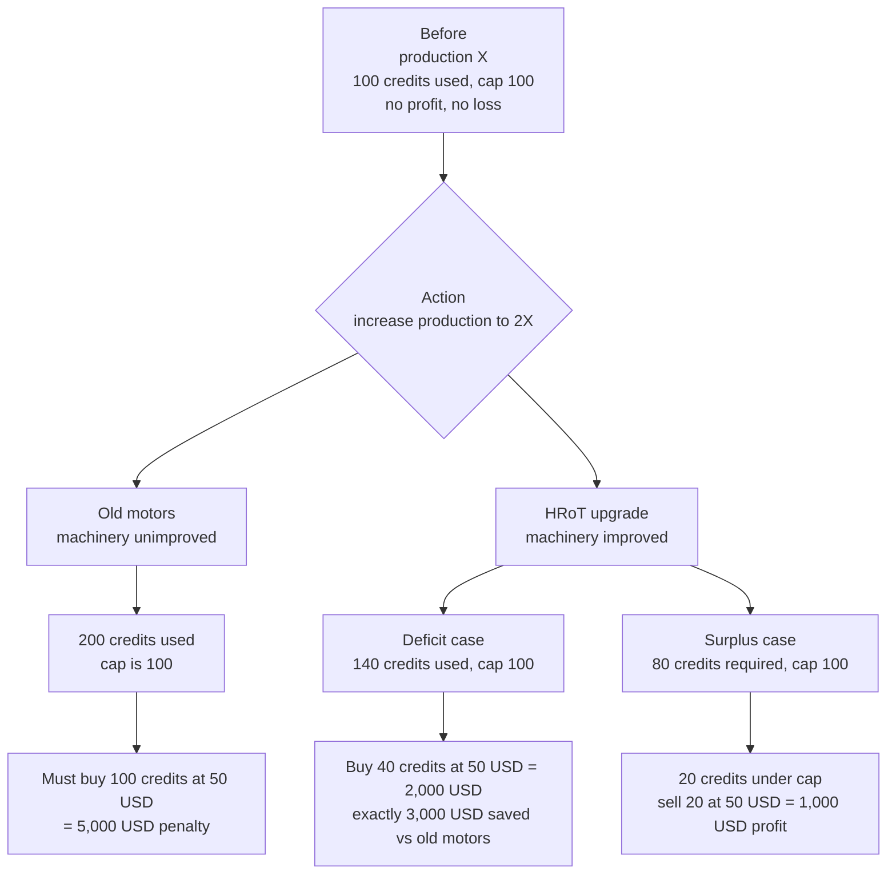
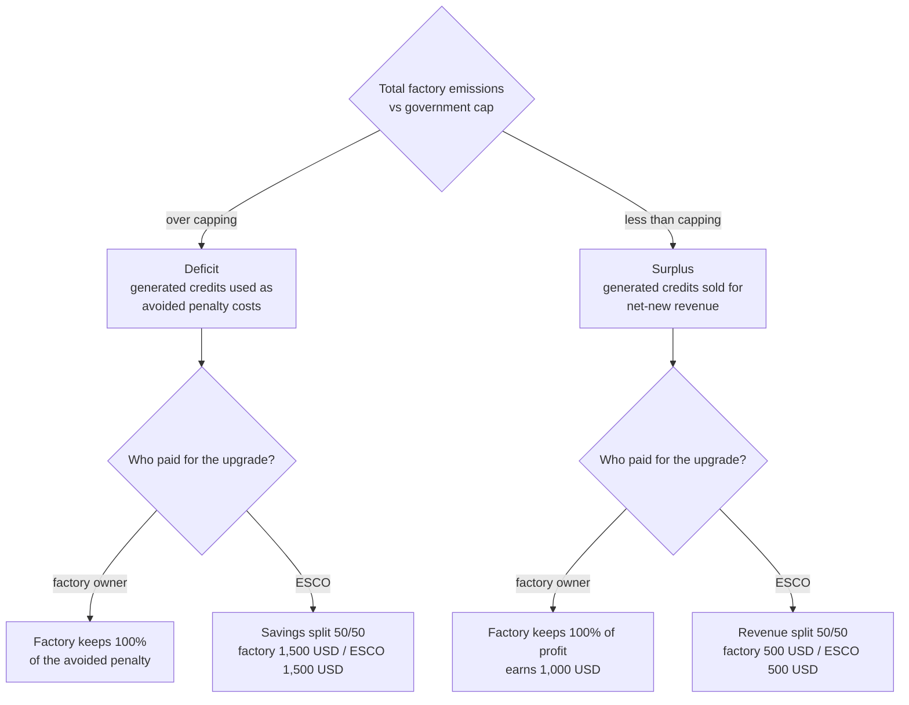
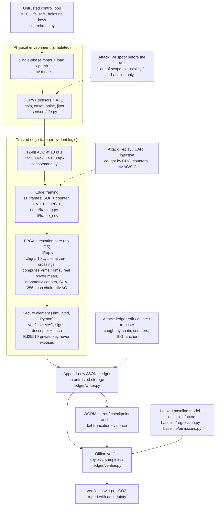
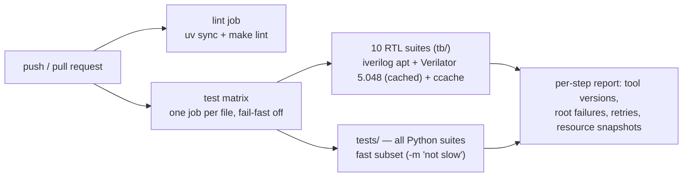

# HRoT Carbon Verification Module

[](https://github.com/RADICAL-devp/Hardware-Root-of-Trust-HRoT-for-Industrial-MRV/actions/workflows/ci.yml)

Simulation proving that energy savings from a legacy industrial motor / pump
retrofit are **measured, controlled and cryptographically attested** — and that
tampering with that evidence is **detected under the stated threat model**.

> **Honest scope.** Simulation proves logic, math and attack detection. It does
> **NOT** prove physical tamper resistance. There are no "unspoofable" or
> "tamper-proof" claims here — tampering is *detected under threat model X*, and
> the attacks we miss are listed, not hidden. See
> [`docs/threat_model.md`](docs/threat_model.md).

One-command reproduction:

```sh
uv sync && make repro        # SEED=42, full 522-test suite, deterministic
```

---

## Contents

1. [Why: the carbon-credit problem](#1-why-the-carbon-credit-problem)
2. [System architecture](#2-system-architecture)
3. [End-to-end data flow (byte layouts)](#3-end-to-end-data-flow-byte-layouts)
4. [Sensors: how measurement works](#4-sensors-how-measurement-works)
5. [RTL: the hardware attestation core](#5-rtl-the-hardware-attestation-core)
6. [Edge, secure element, ledger, verifier](#6-edge-secure-element-ledger-verifier)
7. [Plant models, control, baseline, emissions](#7-plant-models-control-baseline-emissions)
8. [Simulations, testbenches and campaigns](#8-simulations-testbenches-and-campaigns)
9. [Measured results](#9-measured-results)
10. [Workflows: gates, CI, dashboard](#10-workflows-gates-ci-dashboard)
11. [Repository map](#11-repository-map)
12. [Honest limitations and open items](#12-honest-limitations-and-open-items)
13. [Documentation index](#13-documentation-index)

---

## 1. Why: the carbon-credit problem

Industrial sites run legacy (direct-on-line, valve-throttled) motors that waste
a large fraction of their input power. A **VSD/HRoT retrofit** cuts energy per
unit of production. Under a carbon-cap scheme, those savings have **monetary
value** — but only if the saved energy can be *measured, reported and verified*
(MRV) in a way a third party can trust. That verification layer is what this
module builds; the credit math below (transcribed from the project's design
diagrams) is the business context, not something the code computes.

### 1.1 Credit mechanics under a 2× production increase



### 1.2 Where the verified savings go (factory owner vs ESCO)



The module's job in both branches: produce a ledger that an offline verifier —
holding only the device's public key — can check without trusting the site, the
network, or the control system. Everything downstream (audit, credit issuance,
ESCO settlement) depends on that.

## 2. System architecture

Aspects of the architecture: a **tamper-evident edge** (12-bit ADC → framing →
no-OS FPGA core → secure element) signs each measurement record at the source;
the ledger lives in **untrusted storage** and is mirrored to a WORM
anchor; **verification is offline and keyless**; the **control loop is
untrusted and holds no keys**. Attack annotations mark what is caught where,
and what is explicitly out of scope.



### Trust boundaries

| Domain | Runs | Holds | Can | Cannot |
|---|---|---|---|---|
| Plant + sensors (simulated) | `plant/`, `sensors/` | physics state | produce noisy V/I | — |
| Tamper-evident edge | `edge/`, `rtl/` | FPGA-internal state | frame, window, hash, HMAC, count | read the Ed25519 private key |
| Secure element | `edge/secure_element.py` | Ed25519 private key, HMAC key | sign, verify HMAC, refuse | be driven to sign on HMAC mismatch |
| Ledger storage | `ledger/writer.py` output (JSONL) | nothing | store records | forge chain/signature |
| Control loop | `control/` | nothing | propose setpoints | mint or modify records |
| Verifier | `ledger/verifier.py` | Ed25519 **public** key (+ optional anchor) | validate, flag, classify | see samples or keys; recompute HMAC |

Keys are provisioned deterministically for the simulation
(`sim/provision.py`, `keys/` is gitignored; only fake vectors are committed) —
a production key-lifecycle ceremony is out of scope for this phase.

## 3. End-to-end data flow (byte layouts)

```mermaid
flowchart LR
    S["Samples at 10 kHz<br/>V, I quantized Q15"] --> F["L0 frame, 11 B<br/>SOF, counter, V, I, CRC16"]
    F --> W["Window = 10 grid cycles<br/>M in 1810..2230 samples<br/>Vrms, Irms, P_AVG, ENERGY"]
    W --> R["Record at 1 Hz<br/>5 sub-windows, 36 B descriptor"]
    R --> H["WINDOW_HASH = SHA-256<br/>(prev_hash + V/I/P samples + descriptor)"]
    H --> M2["HMAC = HMAC-SHA256<br/>(key, descriptor + window_hash)"]
    M2 --> G["SIG = Ed25519<br/>(HMAC + descriptor + window_hash)"]
    G --> L["JSONL ledger row"]
    L --> V["Verifier: signature, chain, counters, flags"]
    V --> O["Baseline savings estimate + CO2 interval"]
```



**Step 1 — one sample → one L0 frame** (`edge/framing.py` ↔ `rtl/frame_rx.v`):

| Field | Bytes | Type | Notes |
|---|---|---|---|
| `SOF` | 1 | u8 | constant `0xA5` |
| `counter` | 4 | u32 LE | per-sample monotonic index (10 kHz) |
| `V` | 2 | i16 LE | Q15 normalized, full-scale ±500 Vpk |
| `I` | 2 | i16 LE | Q15 normalized, full-scale ±100 Apk |
| `CRC16` | 2 | u16 LE | CRC16-CCITT-FALSE over `counter‖V‖I` |

**Step 2 — one window** (`sensors/windows.py` ↔ `rtl/zc_detect.v` +
`rtl/power_calc.v`): a window spans **10 whole grid cycles** with a variable
sample count `M ∈ [1810, 2230]` (45–55 Hz at 10 kHz). Cycle boundaries come
only from **rising zero crossings detected on the measured, quantized
voltage** — the true grid frequency is never used by the measurement logic. A
window is valid iff every inter-crossing gap is in `[150, 260]` samples and
`M` is in range; invalid windows are **flagged, never healed**. Each window
yields Vrms, Irms, P_avg (exact mean over valid samples) and an integer
`ENERGY_UWH` increment.

**Step 3 — one 1 Hz record** (`edge/attestation.py`): 5 consecutive
sub-windows (valid or flagged) become one record with a **36-byte descriptor**
(little-endian, `struct "<II5HBBIiQ"`):

| Offset | Field | Type | Meaning |
|---|---|---|---|
| 0 | `counter` | u32 | attestation record counter |
| 4 | `window_start` | u32 | sample index at record start |
| 8 | `zc_samples[5]` | 5×u16 | per-sub-window sample counts |
| 18 | `window_flags` | u8 | bit5 `NEG_ENERGY`, bit6 `OVERRUN`, bit7 `HASH_OVERFLOW` |
| 19 | `overrun_cnt` | u8 | tombstone slots this record |
| 20 | `device_id` | u32 | device identity |
| 24 | `p_avg_q30` | i32 | mean real power, Q30 |
| 28 | `energy_uwh` | u64 | integer µWh increment (clamped: see below) |

The three integrity bindings, implemented side-by-side in Verilog and Python:

- `WINDOW_HASH = SHA-256(prev_hash ‖ V‖I‖P samples ‖ descriptor)` — the
  descriptor is hashed **last** so the stream can start before P_avg/energy are
  known (Week 5c reorder); every sample of all 5 sub-windows is included,
  valid or not (invalid windows contribute samples to the hash but zero
  energy).
- `HMAC = HMAC-SHA256(hmac_key, descriptor ‖ window_hash)` — 32 bytes.
- `SIG = Ed25519(HMAC ‖ descriptor ‖ window_hash)` — 64 bytes over a 100-byte
  preimage, produced only by the secure element (`edge/secure_element.py`),
  which refuses to sign on HMAC mismatch.

**Negative-energy policy** (synthetic/adversarial data only): if a record's
energy total would go negative it is clamped to 0 with `NEG_ENERGY` set and
`P_AVG` kept signed-exact. Fail-loud was rejected: one bad window must not halt
attestation (availability), and the clamp is itself attested.

**Step 4 — the ledger row** (`ledger/writer.py`): one compact JSON object per
line — `{schema, device_id, counter, window_start, zc_samples, window_flags,
overrun_cnt, p_avg_q30, energy_uwh, prev_hash_hex, window_hash_hex, hmac_hex,
descriptor_hex, sig_hex, telemetry, telemetry_attested}`. Record 0 hashes
`prev_hash = 00…00` (genesis); each later `prev_hash` must equal the previous
`window_hash`, and the writer refuses to emit a record that breaks the chain.
`telemetry` (FPGA health counters such as CRC errors/resyncs) is carried
verbatim and marked `telemetry_attested: false` — untrusted diagnostics must
never be mistaken for attested data.

**Step 5 — offline verification** (`ledger/verifier.py`): keyless and
sampleless. Per record it collects every failing check in a canonical order
(`malformed, bad-device-id, bad-descriptor, bad-overrun, bad-overrun-range,
bad-bit7, bad-genesis, bad-chain, bad-replay, bad-continuity, bad-gap,
bad-invalid-count, bad-neg-clamp, bad-range, bad-signature`). Ledger-level: a
second genesis marks the ledger **not acceptable for issuance**; an anchor head
ahead of the ledger tail flags **tail-truncation**; records overshooting the
anchor flag **anchor-mismatch**; with no anchor the tail is **unverified** (a
documented miss — only the anchor bounds the end of the ledger).

**Step 6 — savings and CO2** (`baseline/`): the verifier's output feeds an
IPMVP-style baseline model and an emission-factor model to produce savings and
avoided-emissions estimates with uncertainty (Section 7).

## 4. Sensors: how measurement works

All sensor paths have noise and 12-bit quantization from day one — there is no
perfect-world path, and there is no bypass of the measurement chain.

| Stage | Module | What it models | Defaults (fixed before any bound was computed) |
|---|---|---|---|
| Analog front end | `sensors/afe.py` | sampling jitter (interpolated), gain error, offset error, additive white Gaussian noise, per channel; seeded RNG | ±0.4 % / −0.3 % gain, 0.8 V / 0.05 A offset, ≈1.4 LSB rms noise, 1 µs rms jitter |
| ADC | `sensors/adc.py` | 12-bit bipolar straight-binary coding, saturating clip (no wrap) | ±500 Vpk (LSB 0.244 V), ±100 Apk (LSB 0.0488 A) |
| Windows | `sensors/windows.py` | integer rising-ZC detector + window validator; `[S, E)` convention | N=10 cycles, arm at < −328 codes (−5.0049 V), gap [150, 260], M [1810, 2230] |

Design rules encoded in these modules: all draws come from a seeded
`numpy.random.default_rng` stream, so any seed reproduces the exact noisy
trace; the detector uses integer thresholds only; hysteresis is on the measured
signal, never the plant's true state; a fractional interpolated crossing
position is reported for diagnostics but never decides edges.

**Measured results (SEED=42, committed in `results/metrics.json`):**

- Week 2 (fixed windows, steady/cyclic/bursty): P error mean/max =
  **0.101/0.213 %, 0.103/0.217 %, 0.102/0.223 %** — all under the
  spec-derived acceptance bound of **1.506 %** (noise parameters were frozen
  before the bound was computed; nothing was tuned to pass).
- Week 2b (zero-crossing vs fixed windows under noise + 3 %/1 % voltage
  harmonics + 2 V DC offset, ±0.5 Hz drift): fixed-window bias **0.66–0.68 %
  mean / 1.11–1.13 % max**; ZC residual **0.10 % mean / 0.13–0.14 % max**,
  flat across the sweep, **100 % windows valid** (~8× better, no tuning).
  Figures: `results/figures/zc_vs_fixed_sweep.png`,
  `results/figures/*_clean_vs_measured.png`.

## 5. RTL: the hardware attestation core

Verilog-2005, one clock domain, no latches (asserted 0 by synthesis and
tests), async-assert/sync-release reset. The Python golden model
(`tb/golden.py`) is the source of truth; every module is tested under **both
Verilator and Icarus** through cocotb, and RTL must match the golden model
bit-exactly.

| Module | Role | Key contract |
|---|---|---|
| `rtl/uart_rx.v` | 8N1 UART byte receiver | `CLK_PER_BIT=8` → 1.5 Mbaud at 12 MHz; mid-bit sampling; tolerates ±2 % baud error and back-to-back frames; bad stop bit drops the byte and pulses `framing_error` |
| `rtl/frame_rx.v` | L0 framer | SOF hunt, 11-byte assembly, CRC16 gate, resync (searches failed candidates for an inner SOF); saturating telemetry counters (`crc_err_cnt`, `resync_cnt`) + sticky `cnt_saturated`; counter continuity is deliberately *not* checked here (that is the Python receiver's job) |
| `rtl/zc_detect.v` | rising-ZC detector + validator | bit-exact map of `sensors/windows.py`; detection sample index **is** the window boundary; `[S, E)` windows; invalid → `win_valid=0`, flagged, never healed |
| `rtl/power_calc.v` | per-window fixed point | accumulates integer sums, then runs a **fixed 401-cycle schedule** (E0→E400): `div_fsm` ×4, `sqrt_fsm` ×2, energy increment, PF; invalid windows run the same schedule with safe operands and forced-zero outputs (constant latency, no divide-by-zero); `p_avg_exact` is the sole descriptor source; the reciprocal-LUT mean is advisory-only and disabled in production (`LUT_MEAN_ENABLE=0`) |
| `rtl/div_fsm.v` | divider | 66 cycles, half-away-from-zero rounding; bit-equals `div_round_half_away` in Python |
| `rtl/sqrt_fsm.v` | square root | 34 cycles, half-up; 33-bit port (isqrt(2⁶⁴−1) rounds to 2³²) |
| `rtl/record_agg.v` | record aggregation | 5 sub-window slots; signed energy accumulation; **one** NEG_ENERGY clamp per record (bit 5); tombstone/overrun counting (bit 6); packs the five M values |
| `rtl/skid_buf.v` | 16-deep byte FIFO | FWFT; sticky overflow: a byte pushed while full is **dropped and flagged**, never silently |
| `rtl/sha256_wrap.v` | streaming SHA-256 | wraps one pinned secworks core; 256-byte input FIFO with real backpressure; owns padding (0x80 + 64-bit bit-length); `init` aborts and restarts; sticky overflow |
| `rtl/hmac_core.v` | HMAC-SHA256 sequencer | FIPS 198; keys > 64 B are pre-hashed; drives the *same* wrap engine (one hash core total); valid-hold handshake, so no self-inflicted overflow is possible |
| `rtl/chain_ctrl.v` | hash-chain record sequencer | message = `prev ‖ samples ‖ descriptor` (descriptor last); 9-phase frozen contract; genesis = zero prev for record 0; ready-gated sample streaming; sticky overflow aborts |
| `rtl/win_counter.v` | monotonic counter | advances **only** on valid record closes; at 2³²−1 it **halts** with a sticky flag — it never wraps or saturates, because counter reuse would be nonce reuse; reset behavior is documented as needing non-volatile memory in real hardware |
| `rtl/top.v` | integration | `uart_rx → frame_rx → zc_detect → power_calc → record_agg`, plus a sample tap (`V‖I‖P`, 8-byte atomic units) through the skid into `chain_ctrl`; descriptor latched at window close; the chain and HMAC share one `sha256_wrap` via a mux that switches only at job boundaries; per-record clear domain; boundary ownership `[S, E)` with `boundary_hold`; on counter halt it suppresses further `record_valid` (fail-closed) |

Additional pinned properties, measured by the testbenches on both simulators:

- RTL vs golden identity: **0 LSB error on every field** across 1,000 random
  vectors + directed + real-rate windows.
- Window latency: **401 cycles** (E0→E400 inclusive), constant for valid and
  invalid windows.
- L0 robustness: 10,000 seeded frames with **zero false rejects**; mixed
  valid/invalid sequences with zero false rejects over 2,000 signed records;
  all post-signing flips in attested fields rejected.
- Every CRC rejection, resync, overrun and saturation event has an explicit
  counter — no silent drops anywhere in the datapath.

**Third-party:** `rtl/third_party/secworks-sha256/` is the upstream secworks
SHA-256 core at pinned commit `837c5cc396f001d18f2c765721c585716eb439ae`,
BSD-2-Clause, unmodified. Our wrapper owns padding/length encoding. A test pins
the SHA-256 manifest of every file under that tree, so any
modification/addition/deletion fails CI. See
[`docs/THIRD_PARTY.md`](docs/THIRD_PARTY.md).

**Synthesis and fit (Yosys 0.66, `synth/top.ys`; pinned in
`results/synth_metrics.json`):** LUT4 **15,851**, FF **10,979**, CARRY
**2,768**, BRAM **0**, inferred latches **0**. The UP5K fit probe
(`results/synth_fit.json`) reports **23,602 / 5,280 ICESTORM_LC = 447 %,
placed = false** — the design as written **does not fit** the smallest iCE40
target; Fmax is **unmeasured** (placement fails before timing). These are
recorded honestly, not fixed by silence.

## 6. Edge, secure element, ledger, verifier

| Module | What it is |
|---|---|
| `edge/framing.py` | L0 codec + stateful byte-stream resynchroniser; CRC16-CCITT-FALSE; Q15 maps pinned exactly to the ADC full-scales |
| `edge/receiver.py` | Python reference receiver: strict L0 continuity — seen counters are replays, lower-than-watermark unseen counters are reorders (rejected, counted), jumps are accepted-but-gapped, end-of-stream holes are reported; record policy re-derives the descriptor from integer fields and **cross-checks both directions** against the transported bytes |
| `edge/attestation.py` | the golden record builder: descriptor packing, WINDOW_HASH, HMAC, energy/P_avg encodings; the single source of truth the RTL matches byte-for-byte |
| `edge/secure_element.py` | simulated SE: owns Ed25519 + HMAC keys; constant-time HMAC check; signs the 100-byte preimage; API exposes `{attest, public_key}` only — the private key cannot be extracted through any method |
| `sim/provision.py` | deterministic key derivation from `SEED` via SHA-256 domain separation (`keys/` gitignored; only fake fixtures committed) |
| `ledger/writer.py` | JSONL writer: re-packs the descriptor, verifies the 36-byte round trip, demands SE signing, enforces chain continuity at write time |
| `ledger/verifier.py` | keyless, sampleless verifier (Section 3, step 5); `classify()` maps verdicts to baseline classes and is importable from a clean interpreter |

## 7. Plant models, control, baseline, emissions

### Plant models (`plant/`)

| Module | Model | Status |
|---|---|---|
| `pump.py` | affinity-scaled pump + system curve with static head, `eta(Q,n)`, solved (not assumed) retrofit speed, legacy valve-throttle arm, declared drive efficiency `eta_drive = 0.95` | **production** arm for the Week 6M savings acceptance |
| `dq_machine.py` | three-phase dq machine with flux/frequency-dependent core loss `P_core = P_core_nom (λ/λ_nom)² [(1−c)(f/f_nom) + c(f/f_nom)²]`, synthetic `P_core_nom = 151.143 W/phase`, eddy fraction c = 0.5 | physics basis (Week 6K/6L); validated identities below |
| `mechanics.py` | Stage-A rigid direct-coupled single-inertia shaft dynamics (documented as *not* two-inertia: no gearbox compliance/backlash) | motor experiments |
| `motor.py`, `thermal.py`, `load_profiles.py` | single-phase equivalent circuit + slip, first-order thermal state, seeded steady/cyclic/bursty profiles | Week 2 measurement + superseded Week 6 experiments |

Week 6K/6L physics results (committed, actual runs): dq-vs-committed-circuit
torque gap ≤ **0.83 %** inside the operating range (informational bound 2 %);
analytic-shunt-vs-dq 3.3e−14; 1 s energy-balance residual 2.9e−11; step
residual 1.6e−6; stability gate λ_max·dt = **0.0042 < 0.005 PASS**; core-loss
flux/frequency identities to ~1e−16 and 5.3e−9 at 40 Hz; V/f flux deviation
≤ 6.9 % without a low-frequency boost; the committed 3.6440 N·m unbalance
reference is **not reproduced** (this model: 1.292 N·m) and is labelled
non-reproduced rather than chased. Mutation campaigns: `make mutants-week6k`
**6/6** and `make mutants-week6l` **5/5** injected physics bugs caught.

### Control (`control/`) — untrusted, holds no keys

MPC (`mpc.py`) with a 1-state thermal prediction model (ΔT), torque-capability
constraint `L(u) = C0 + C1·u` calibrated from plant simulation, deterministic
OSQP (iteration limit; wall-clock limits are test-only), a failsafe fallback
(`failsafe.py`), and event attribution. It is deliberately simplistic (load
does not heat the model's temperature state), and — important for reading the
results — **the production pump savings loop has no MPC in it at all**: the
retrofit arm is a VSD at a solved speed. The MPC belongs to the superseded
motor experiments, where it was also the subject of a Week 7 attack
(compromised-MPC wasteful control, detected as negative savings, not
prevented).

### Baseline (`baseline/regression.py`)

IPMVP-style model `E = β₀ + β₁·Load + β₂·Temp + β₃·Load²` fitted on
**pre-retrofit data only** (leakage is prevented by API and tested), with
validation RMSE/MAE, CV(RMSE)/NMBE reporting, and bootstrap confidence
intervals (1,000 resamples). Known open item: the internal train/validation
split is a *random* 80/20 split, which is not time-aware for time-series
energy data (see open items).

### CO2 (`baseline/emissions.py`)

Synthetic hourly emission-factor curve `EF(h) = 0.4 + 0.1 sin(2πh/24) +
0.05 sin(2π·day/365)` kg CO2/kWh, replaceable via `custom_ef_func`.
Conversions are unit-tagged (`uwh_to_kwh` is correct: 1 kWh = 1e9 µWh), and
"avoided emissions" clamp negative savings to zero **by design** (a separate
"net impact" reporting is an open item, as is a conversion bug in an unused
helper — Section 12).

## 8. Simulations, testbenches and campaigns

### Run scripts (`sim/`)

| Script | Produces | Status |
|---|---|---|
| `run_week2.py` | plant + sensor-chain measurement error (3 profiles) → `metrics.json` | current |
| `run_week2b.py` | ZC-vs-fixed window stress sweep + figure | current |
| `run_week6.py` | motor/MPC/baseline closed-loop experiment → `week6`, `week6c_stageA` | **superseded** (kept, labelled; no positive savings demonstrated — total GT savings negative) |
| `run_week6k.py`, `run_week6l.py` | dq-machine physics checks → `week6k_dq`, `week6l_coreloss` | current |
| `run_week6m.py` | pre-registered N=100 coverage run (pump retrofit savings) → `week6m_coverage` | current |
| `attacks_week7.py` | 7 attack classes × 128 trials → `week7_attacks` | current |
| `mutants_week6k.py`, `mutants_week6l.py` | mutation checks (rewrite → run suite → restore) | current |
| `gen_recip_lut.py` | reciprocal LUT generation for the advisory mean path | current |
| `provision.py` | deterministic sim keys | current |

Every reported number is produced by an actual run of these scripts and
committed to `results/metrics.json` — the single source of truth. The Week 6M
acceptance criteria were **pre-registered** in `docs/DECISIONS.md` before the
run (N=100, 95 % central interval, model-form term 0.01, gate ≥ 90/100
coverage, cap 7.79 % on the CI half-width), so the gate could not be redefined
after seeing the result.

### Testbenches (`tb/`) — the dual-simulator discipline

- `tb/golden.py` is the Python golden model for all RTL datapath fields.
- Each wrapper (`tb/test_week*.py`) parametrizes one pytest node per
  (simulator × case); **Verilator and Icarus both run**, and a mismatch in
  either is a failure. `WEEK5D_SIM` filters one simulator; `SLOW_CASES` are the
  long nodes excluded from the fast subset and run in `make test-full` /
  `make repro` only.
- On failure, the failing simulator reruns with waveform tracing and copies
  the FST into `results/` — bounds are never loosened; the rerun must fail
  identically.
- `tb/test_week5d_top.py` drives the integrated `top.v` over the UART line;
  `tb/test_week5d3_ledger_fixtures.py` runs the RTL through the real writer and
  byte-compares against committed fixtures (`tests/fixtures/`, SHA-pinned).
- `tb/test_chain.py`, `tb/test_power.py` are early stubs (superseded by the
  Week 4b/5d suites); `attacks/` contains early injector stubs (the live
  campaign is `sim/attacks_week7.py`); `cosim/run_cosim.py` is a planned
  single-run orchestrator (Section 12).

### Week 7 attack campaign (`sim/attacks_week7.py`)

Each attack class is applied to fresh seeds, 128 trials per class, and detected
at one of three layers: the L0 frame stream (`edge.receiver`), the ledger
(`ledger.verifier`), or the energy layer (`plant.pump` savings). The table is
in Section 9; the misses are first-class output, not footnotes.

## 9. Measured results

### Week 7 attack campaign (N=128 trials per class, fresh seeds)

| Attack | Detected | Verdict | Notes |
|---|---|---|---|
| Replay (old valid frame/record) | 128/128 | `bad-replay` | counter/watermark |
| Spoof V/I **with** SE in path | 128/128 | `bad-signature` | attacker lacks HMAC/Ed25519 keys |
| Spoof V/I **without** SE (ablation) | **0/128** | — | **by design**: demonstrates why the SE is required |
| Bit-flip (UART/transport) | 128/128 | `bad-descriptor` | CRC16 + descriptor cross-check |
| Drop (packets/windows) | 128/128 | `bad-chain` | counter gap + chain discontinuity |
| Ledger edit / delete | 128/128 | `bad-descriptor` + `bad-chain` | offline row tampering |
| Compromised MPC (wasteful control) | 128/128 | negative savings | ledger stays *valid* — not a forgery; physical waste is detected at the energy layer, not prevented |
| False-reject rate (honest ledger) | **0.0000** | — | no honest record was rejected |

Documented misses beyond the ablation: pre-AFE analog spoof (a keyless,
sampleless verifier has no samples — only plausibility/baseline residuals see
it), and compromised-MPC waste at the energy layer (shown above). Full table +
miss text in `results/metrics.json['week7_attacks']` and
[`docs/PROGRESS.md`](docs/PROGRESS.md).

### Week 6M savings acceptance (pre-registered; pump retrofit)

| Quantity | Value | Gate |
|---|---|---|
| True savings (noiseless energies) | **17.20 %** of legacy energy | reference, not a target |
| Estimated savings (noisy) | **17.23 % ± 1.42 %** (std), SE 1.76 % | — |
| CI half-width | **4.44 %** of legacy | cap 7.79 % → **PASS** |
| Empirical coverage | **100/100** | gate ≥ 90/100 → **PASS** |
| CIs excluding zero | **100 %** | reported |
| Energies | legacy 0.03827 kWh, retrofit 0.03169 kWh | — |

The 18.78 % analytic prediction stayed a pre-registered reference, never a
target. The superseded `week6` / `week6c_stageA` artifacts (motor + MPC
experiment, negative total savings, 180/180 instantaneous torque violations in
the constant-torque experiment) remain in git and in `metrics.json`, labelled
superseded — the pump plant exposes no electromagnetic torque or temperature,
so those criteria could not be evaluated there (owner decisions 1/B and 4).

### Blueprint targets vs measured

| Blueprint target | Measured |
|---|---|
| Savings estimate error < 2–3 % | replaced by interval coverage (owner decision 4): coverage 100/100, half-width 4.44 % ≤ 7.79 % |
| Tamper detection per class, aim 100 % in-scope | 6 classes 128/128; ablation miss documented |
| False-reject rate < 1 % | 0.0000 |
| RTL latency per window stated in cycles | 401 cycles (E0→E400), dual-simulator measured |
| FPGA resources | 15,851 LUT4 / 10,979 FF / 0 BRAM — **does not fit UP5K (447 %)** |
| Control safety (zero violations) | superseded motor experiment had 180/180 instantaneous violations; the production pump model has no torque samples (option B) |

## 10. Workflows: gates, CI, dashboard

### Make targets (what to run when)

| Target | What it does | Recorded result |
|---|---|---|
| `make sync` | `uv sync` (Python 3.12) | — |
| `make lint` | `ruff check` + `ruff format --check` | clean |
| `make test` | pytest, non-slow subset | — |
| `make test-quick` | Week 6/7/8 Python suites only (~1.5 min, no RTL sims) | 161 passed |
| `make test-full` | **everything**, including slow RTL sims | 522 passed / 1:48:35 |
| `make repro` | full suite at **SEED=42** (bit-reproducible) | 522 passed / 1:30:20 |
| `make attacks-week7` | Week 7 campaign (rewrites `week7_attacks` in metrics.json) | 5.47 s |
| `make mutants-week6k` / `-week6l` | physics mutation checks (rewrite, test, restore) | 6/6 / 5/5 caught |
| `make synth` | Yosys resource flow | `results/synth_metrics.json` |
| `make dashboard` | Streamlit evidence dashboard | reads `metrics.json` |
| `make ci-local` | lint + non-slow pytest (CI parity on your machine) | — |

Gates must pass before any phase is declared done:
**`make lint` → `make test-quick` → `make test-full` → `make repro`**, each
named with its real numbers in `docs/PROGRESS.md`.

### CI (`.github/workflows/ci.yml`)



Design notes: one job per test file so failures attribute without log access
and a hung file cannot block others; Verilator 5.048 is built from source once
and cached; ccache (content-addressed) keeps rebuilds cheap; a retry layer
distinguishes **infra crashes** (`FLAKY-INFRA`, e.g. simulator killed under
load) from real assertion failures — a detected infra crash is retried once and
reported loudly; the full slow-node suite runs locally via
`make test-full`/`make repro`.

### Evidence workflow (Week 8)

```sh
make repro          # regenerate all numbers (SEED=42)
make dashboard      # Streamlit: Savings / Attacks / Physics / Gates tabs
```

- `results/metrics.json` — the single source of truth; the dashboard renders
  it directly (`dashboard/app.py`), and `tests/test_dashboard.py` pins the
  loader and all four tabs.
- `docs/deck.md` — 10-slide deck (Marp-compatible Markdown) for the demo.
- `docs/SCREEN_RECORDING.md` — checklist for the 5-minute screen recording.

## 11. Repository map

```
attacks/        early attack-injector stubs (live campaign: sim/attacks_week7.py)
baseline/       IPMVP regression (regression.py) + emission factor (emissions.py)
control/        MPC, failsafe, torque capability — untrusted, holds no keys
cosim/          planned single-run orchestrator (stub; see open items)
dashboard/      Streamlit evidence dashboard (reads results/metrics.json)
docs/           BLUEPRINT, DECISIONS, PROGRESS, threat model, deck, recording, ...
edge/           L0 framing/receiver, record builder, simulated secure element
ledger/         JSONL writer + keyless/sampleless verifier
plant/          motor, dq machine, mechanics, pump, thermal, load profiles
results/        metrics.json (source of truth), synth metrics, fit probe, figures
rtl/            Verilog core (top.v + units) + third_party/secworks-sha256 (pinned)
sensors/        AFE, 12-bit ADC, zero-crossing windows
sim/            run scripts, Week 7 campaign, mutant checks, key provisioning
synth/          Yosys flow (top.ys, run_synth.py) + UP5K fit probe
tb/             cocotb testbenches + golden model (Verilator × Icarus)
tests/          Python suites (measurement, framing/signing, RTL-ledger fixtures,
                baseline/MPC, 6K/6L/6M, attacks, dashboard) + SHA-pinned fixtures
PROMPTS.md      original phased execution prompts (project history)
```

## 12. Honest limitations and open items

**Scope**

- Simulation only: proves logic, math and attack detection **under the stated
  threat model**. No physical tamper-resistance claim; no "unspoofable" /
  "tamper-proof".
- Out of scope by design (see `docs/threat_model.md`): key extraction from
  real silicon, pre-AFE analog spoofing (physics), trust-anchor swap, sustained
  availability under jamming, grid emission-factor fraud, three-phase imbalance
  attacks (single-phase first).
- The Week 6M savings magnitude rests on a **synthetic pump/curve parameter set
  and a declared drive efficiency (0.95)**; a real machine may differ. The
  measurement/attestation machinery is the contribution, not the 17.2 %.

**Known open items (reported, not hidden)**

- **6M noise model**: `sim/run_week6m.py` represents the AFE/ADC contribution
  as a scalar fractional energy-noise draw (σ = 1.5 %, from the AFE/ADC spec)
  per arm, rather than driving the full per-sample AFE→ADC chain for each of
  the 100 draws; the per-sample chain is exercised by Week 2/2b and the ledger
  path by Weeks 5/7. A full-chain 6M re-run is future work.
- **Emissions conversion**: `baseline/emissions.py::estimate_emissions_from_windows()`
  divides µWh by `1e6` instead of `1e9` (a 1000× overstatement of kWh). The
  helper currently has **no callers** — live paths use the correct
  `uwh_to_kwh()` — but it is a landmine to fix with unit tests before anything
  uses it.
- **Hardware feasibility**: UP5K does not fit (**447 %** ICESTORM_LC,
  placement fails); Fmax is **unmeasured**; the record chain-tail varies by up
  to ~101 cycles with message length (unresolved). No hardware-readiness claim
  is made.
- **Baseline validation split**: `baseline/regression.py` uses a random 80/20
  split, not a time-aware split — unsuitable for production time-series
  validation; the committed baseline numbers feed the 6M cap derivation, so
  changing it requires a superseding decision, not a silent edit.
- **End-to-end orchestrator**: `cosim/run_cosim.py` is a stub; today's
  end-to-end coverage is the union of `sim/run_week2` (plant→sensors→windows),
  `tb/` (framing→RTL→ledger fixtures) and `sim/attacks_week7` (attacks). A
  single hashed run-bundle orchestrator is the planned next step.
- **Key lifecycle**: provisioning is deterministic-seeded and simulation-only;
  rotation, revocation and epoch handling are out of scope; the threat model
  lists trust-anchor swap as not defended.
- **Negative savings reporting**: "avoided emissions" clamps at zero by
  design; a separate net-impact number (gross savings vs energy penalty) is
  future work, as is time-resolved marginal emission factors.

## 13. Documentation index

| Document | Content |
|---|---|
| [`docs/BLUEPRINT.md`](docs/BLUEPRINT.md) | source of truth: architecture, specs, 8-week plan, metrics, pitfalls |
| [`docs/DECISIONS.md`](docs/DECISIONS.md) | every owner decision, amendment, pre-registration and finding |
| [`docs/PROGRESS.md`](docs/PROGRESS.md) | per-phase done / next / open risks with real gate numbers |
| [`docs/threat_model.md`](docs/threat_model.md) | STRIDE assets/attackers, in-scope attacks, explicit NOT-defended list |
| [`docs/deck.md`](docs/deck.md) | 10-slide demo deck (Marp) |
| [`docs/SCREEN_RECORDING.md`](docs/SCREEN_RECORDING.md) | 5-minute recording checklist |
| [`docs/THIRD_PARTY.md`](docs/THIRD_PARTY.md) | secworks provenance, license, pinned commit |
| [`docs/DECISION_MEMO.md`](docs/DECISION_MEMO.md) | Week 6G decision memo (torque-criterion infeasibility analysis) |
| [`results/metrics.json`](results/metrics.json) | every reported number, from actual runs |

Third-party attribution: SHA-256 RTL © Joachim Strömbergson (secworks),
BSD-2-Clause, vendored unmodified at a pinned commit — see
`rtl/third_party/secworks-sha256/LICENSE` and `docs/THIRD_PARTY.md`.
